# Laporan Praktikum Pemrograman Mobile – Pertemuan 8: Model User & Admin dengan REST API

**Nama:** Masyhuri Yudhistira  
**NIM:** 20240801229

## 1. Identitas dan Perhitungan N

| Keterangan | Nilai |
|---|---|
| Nama | Masyhuri Yudhistira |
| NIM | 20240801229 |
| 3 digit terakhir NIM | 229 |
| N (angka tengah digeser ke belakang) | 2-2-9 → 2-9-2 = 292 |
| ID User | 1499 + N = 1499 + 292 = 1791 |
| ID Admin | 792 + N = 792 + 292 = 1084 |

Tiga digit terakhir NIM adalah 229. Angka tengahnya (2) dipindah ke paling belakang sehingga menjadi 292. Nilai N ini dipakai untuk menghitung ID User (1791) dan ID Admin (1084) yang dipakai saat pengujian.

Semua nilai tersebut disimpan di satu file, yaitu `lib/utils/constants.dart`, supaya tidak ditulis berulang di banyak tempat:

```dart
const String NAMA = 'Masyhuri Yudhistira';
const String NIM = '20240801229';

// N: 3 digit terakhir NIM = 229,
// angka tengah (2) digeser ke belakang -> 292
const int N = 292;

const int USER_ID = 1499 + N; // 1791
const int ADMIN_ID = 792 + N; // 1084

const String APP_TITLE = '$NAMA - $NIM';
const String BASE_URL = 'http://localhost:3000';
```

## 2. Alasan Menggunakan json-server

Pada praktikum sebelumnya API yang dipakai adalah jsonplaceholder.typicode.com. Saat dicek, API tersebut tidak punya endpoint `/admins` dan tidak benar-benar menyimpan data. Hasil pengecekannya:

| Request | jsonplaceholder | json-server (lokal) |
|---|---|---|
| GET /admins/1084 | 404, endpoint tidak ada | 200, data admin tampil |
| POST /users (id 1791) | 201, tapi id diganti jadi 11 | 201, id tetap 1791 |
| GET /users/1791 setelah POST | 404, data tidak tersimpan | 200, data ada |
| DELETE /users/1791 | 200 walaupun data tidak ada | 200, data benar-benar terhapus (GET berikutnya 404) |

Karena itu dipakai json-server versi 0.17.4 yang berjalan di laptop sendiri. Datanya diambil dari file `mock_api/db.json` yang berisi 10 user dan 5 admin, termasuk admin ID 1084. User ID 1791 sengaja tidak dimasukkan dari awal karena akan dibuat lewat POST. Setiap perubahan (POST, PUT, PATCH, DELETE) langsung disimpan ke file, jadi hasilnya bisa dicek ulang dan status code-nya asli. File `mock_api/db.backup.json` disiapkan untuk mengembalikan data ke kondisi awal.

Cara menjalankan server (dari folder proyek):

```
npx json-server@0.17.4 --watch mock_api/db.json --port 3000
```

BASE_URL di `constants.dart` disesuaikan dengan device: `http://localhost:3000` untuk Chrome/Windows dan `http://10.0.2.2:3000` untuk emulator Android.

## 3. Struktur File Model dan Service

```
lib/
├── main.dart
├── utils/
│   ├── constants.dart
│   └── ui_helper.dart
├── models/
│   ├── user.dart
│   └── admin.dart
├── services/
│   ├── user_service.dart
│   └── admin_service.dart
└── pages/
    ├── home_page.dart
    ├── user_list_page.dart
    ├── user_detail_page.dart
    ├── admin_list_page.dart
    └── admin_detail_page.dart
mock_api/
├── db.json
├── db.backup.json
└── README.md
```

| File | Fungsi |
|---|---|
| main.dart | Titik awal aplikasi, mengatur tema dan membuka HomePage |
| utils/constants.dart | Konstanta NAMA, NIM, N, USER_ID, ADMIN_ID, dan BASE_URL |
| utils/ui_helper.dart | Dialog hasil/konfirmasi/error, SnackBar, dan tampilan error |
| models/user.dart | Class User (id, name, email, city) + fromJson() dan toJson() |
| models/admin.dart | Class Admin (id, name, email, department) + fromJson() dan toJson() |
| services/user_service.dart | Request HTTP ke /users: GET, POST, PUT, PATCH, DELETE |
| services/admin_service.dart | Request HTTP ke /admins: getAdmins, getAdmin, deleteAdmin |
| pages/home_page.dart | AppBar nama dan NIM + TabBar (tab User dan Admin) |
| pages/user_list_page.dart | Daftar user, tombol POST/PUT/PATCH/DELETE, dan Cari by ID |
| pages/user_detail_page.dart | Detail satu user (GET /users/{id}) |
| pages/admin_list_page.dart | Daftar admin, tombol Lihat dan Hapus Admin ID 1084 |
| pages/admin_detail_page.dart | Detail satu admin (GET /admins/{id}) |

## 4. Implementasi Model User dan Model Admin

### 4.1 Model User

```dart
class User {
  final int id;
  final String name;
  final String email;
  final String city;

  User({
    required this.id,
    required this.name,
    required this.email,
    required this.city,
  });

  // fromJson: mengubah Map (hasil jsonDecode dari API) menjadi objek User
  factory User.fromJson(Map<String, dynamic> json) {
    return User(
      id: json['id'],
      name: json['name'] ?? '',
      email: json['email'] ?? '',
      city: json['city'] ?? '',
    );
  }

  // toJson: mengubah objek User menjadi Map untuk dikirim ke API (POST/PUT)
  Map<String, dynamic> toJson() {
    return {
      'id': id,
      'name': name,
      'email': email,
      'city': city,
    };
  }
}
```

### 4.2 Model Admin

```dart
class Admin {
  final int id;
  final String name;
  final String email;
  final String department;
  ...
  factory Admin.fromJson(Map<String, dynamic> json) {
    return Admin(
      id: json['id'],
      name: json['name'] ?? '',
      email: json['email'] ?? '',
      department: json['department'] ?? '',
    );
  }
}
```

`fromJson()` adalah factory constructor yang menerima `Map<String, dynamic>` hasil `jsonDecode(response.body)`. Nilai setiap key (`id`, `name`, `email`, dan `city` atau `department`) diambil lalu dibuat menjadi objek. Operator `?? ''` dipakai supaya nilainya tidak null kalau key tidak ada. `toJson()` adalah kebalikannya: objek diubah lagi menjadi Map untuk dikirim sebagai body request POST dan PUT.

## 5. Proses GET

Ada empat method GET. Semuanya memakai `http.get()`, lalu `statusCode` dicek. Jika 200, body JSON diubah menjadi objek dengan `fromJson()`. Jika 404 atau gagal, method melempar `Exception` dengan pesan yang jelas.

| Method | Endpoint | Hasil jika berhasil | Jika gagal |
|---|---|---|---|
| getUsers() | GET /users | 200 → List<User> | Exception + status code |
| getUser(id) | GET /users/{id} | 200 → User | 404 → "User dengan ID .. tidak ditemukan" |
| getAdmins() | GET /admins | 200 → List<Admin> | Exception + status code |
| getAdmin(id) | GET /admins/{id} | 200 → Admin | 404 → "Admin dengan ID .. tidak ditemukan" |

```dart
// GET /users -> ambil semua user
static Future<List<User>> getUsers() async {
  final response = await http.get(Uri.parse('$BASE_URL/users'));
  lastStatusCode = response.statusCode;

  if (response.statusCode == 200) {
    final List data = jsonDecode(response.body);
    return data.map((item) => User.fromJson(item)).toList();
  }
  throw Exception(
    'Gagal mengambil daftar user (status code: ${response.statusCode})',
  );
}
```

```dart
// GET /users/{id} -> ambil satu user berdasarkan ID
static Future<User> getUser(int id) async {
  final response = await http.get(Uri.parse('$BASE_URL/users/$id'));
  lastStatusCode = response.statusCode;

  if (response.statusCode == 200) {
    return User.fromJson(jsonDecode(response.body));
  }
  if (response.statusCode == 404) {
    throw Exception('User dengan ID $id tidak ditemukan (status code: 404)');
  }
  throw Exception(
    'Gagal mengambil user (status code: ${response.statusCode})',
  );
}
```

`getAdmins()` dan `getAdmin(id)` di `admin_service.dart` dibuat dengan pola yang sama, hanya endpoint-nya `/admins`. Di halaman, method GET dipanggil lewat `FutureBuilder`: saat menunggu muncul `CircularProgressIndicator`, jika error muncul pesan dan tombol "Coba Lagi", dan jika berhasil data ditampilkan dalam `ListView` berisi `Card`. Variabel `lastStatusCode` menyimpan status code request terakhir supaya bisa ditampilkan di layar.

## 6. Proses POST, PUT, PATCH, dan DELETE User

Semua operasi memakai ID User = 1791. Body dikirim dalam format JSON dengan header `Content-Type: application/json`.

| Operasi | Endpoint | Body | Hasil yang diharapkan |
|---|---|---|---|
| POST | POST /users | `{"id":1791, "name":"Masyhuri", "email":"masyhuri@example.com", "city":"Indonesia"}` | 201 Created, user 1791 tersimpan |
| PUT | PUT /users/1791 | `{"id":1791, "name":"Masyhuri Yudhistira", "email":"masyhuri.yudhistira@ example.com", "city":"Indonesia"}` | 200 OK, name dan email diganti |
| PATCH | PATCH /users/1791 | `{"name":"Masyhuri Yudhistira - Flutter Developer"}` | 200 OK, hanya name yang berubah |
| DELETE | DELETE /users/1791 | `(tanpa body)` | 200 OK, user 1791 terhapus |

```dart
// POST /users -> tambah user baru (id ikut dikirim, yaitu USER_ID)
static Future<User> createUser(User user) async {
  final response = await http.post(
    Uri.parse('$BASE_URL/users'),
    headers: headers,
    body: jsonEncode(user.toJson()),
  );
  lastStatusCode = response.statusCode;

  // 201 Created = data berhasil dibuat
  if (response.statusCode == 201) {
    return User.fromJson(jsonDecode(response.body));
  }
  // json-server membalas 500 kalau ID sudah dipakai
  throw Exception(
    'Gagal menambah user ID ${user.id}, kemungkinan ID sudah ada '
    '(status code: ${response.statusCode})',
  );
}
```

```dart
// PATCH /users/{id} -> ubah sebagian data, di sini hanya name
static Future<User> patchUser(int id, String name) async {
  final response = await http.patch(
    Uri.parse('$BASE_URL/users/$id'),
    headers: headers,
    body: jsonEncode({'name': name}),
  );
  ...
}
```

Perbedaan PUT dan PATCH: PUT mengganti seluruh data, sehingga semua field (termasuk `city`) harus ikut dikirim. Kalau tidak, field itu akan hilang. PATCH hanya mengirim field yang berubah. Untuk PATCH, halaman terlebih dulu mengambil name yang sekarang, lalu menambahkan teks " - Flutter Developer":

```dart
final current = await UserService.getUser(USER_ID);
final newName = '${current.name} - Flutter Developer';
final result = await UserService.patchUser(USER_ID, newName);
```

Setiap aksi menampilkan SnackBar dan dialog berisi endpoint, status code, dan response body. Jika gagal, misalnya POST ditekan dua kali (ID 1791 sudah ada) atau PUT dijalankan setelah user dihapus (404), aplikasi menampilkan dialog error dan tidak crash.

## 7. Proses DELETE Admin

```dart
// DELETE /admins/{id} -> hapus admin berdasarkan ID
static Future<bool> deleteAdmin(int id) async {
  final response = await http.delete(Uri.parse('$BASE_URL/admins/$id'));
  lastStatusCode = response.statusCode;

  if (response.statusCode == 200) {
    return true;
  }
  if (response.statusCode == 404) {
    throw Exception('Admin dengan ID $id tidak ditemukan (status code: 404)');
  }
  throw Exception(
    'Gagal menghapus admin (status code: ${response.statusCode})',
  );
}
```

Alur hapus admin di halaman Admin:

1. Pengguna menekan tombol "Hapus Admin ID 1084".
2. Muncul dialog konfirmasi. Jika memilih "Ya, Hapus", `deleteAdmin(1084)` dipanggil.
3. Jika status code 200, muncul SnackBar dan dialog hasil berisi status code, lalu `refreshData()` memanggil ulang `getAdmins()` sehingga admin 1084 hilang dari daftar.
4. Saat "Lihat Admin ID 1084" dibuka lagi, `getAdmin(1084)` mendapat 404 dan halaman menampilkan pesan "Admin dengan ID 1084 tidak ditemukan".

## 8. Tampilan Akhir dan Hasil Pengujian

Pengujian dilakukan di Google Chrome (Flutter Web) dengan BASE_URL `http://localhost:3000`. Sebelum pengujian, data dikembalikan ke kondisi awal dengan menyalin `db.backup.json` ke `db.json`.

| No | Fitur | Method | Endpoint | Status Code | Hasil |
|---|---|---|---|---|---|
| 1 | Daftar user | GET | /users | 200 | 10 user tampil |
| 2 | Tambah user 1791 | POST | /users | 201 | User 1791 tersimpan, ID tetap 1791 |
| 3 | Cari user by ID | GET | /users/1791 | 200 | Detail user 1791 tampil |
| 4 | Ganti name dan email | PUT | /users/1791 | 200 | Name jadi "Masyhuri Yudhistira", email diganti |
| 5 | Tambah " - Flutter Developer" | PATCH | /users/1791 | 200 | Name jadi "Masyhuri Yudhistira - Flutter Developer" |
| 6 | Hapus user 1791 | DELETE | /users/1791 | 200 | User 1791 terhapus |
| 7 | Daftar admin | GET | /admins | 200 | 5 admin tampil |
| 8 | Detail admin 1084 | GET | /admins/1084 | 200 | Data admin 1084 tampil |
| 9 | Hapus admin 1084 | DELETE | /admins/1084 | 200 | Admin terhapus, daftar tinggal 4 admin |
| 10 | Detail admin 1084 setelah dihapus | GET | /admins/1084 | 404 | Pesan "tidak ditemukan" tampil |

Screenshot hasil pengujian:

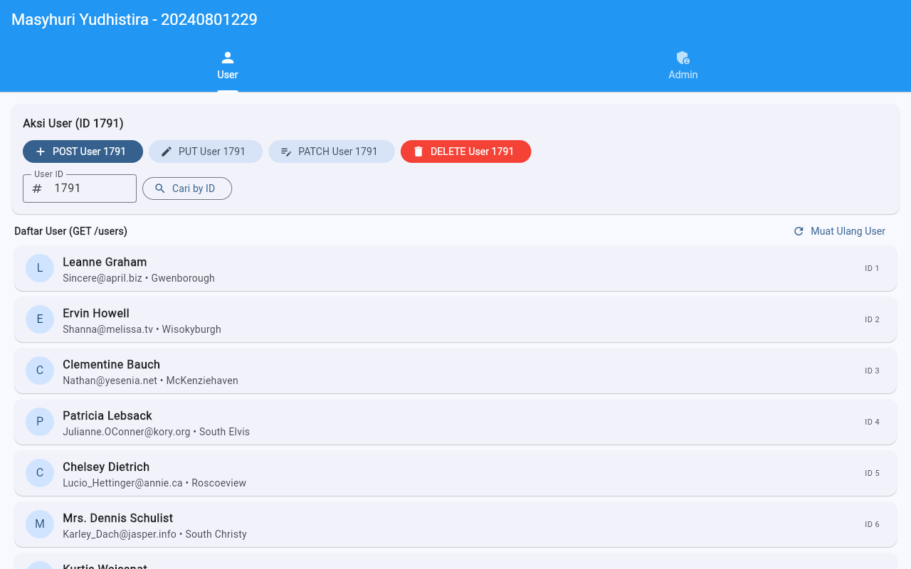

*Gambar 1. Tab User menampilkan daftar user (GET /users, 200 OK)*

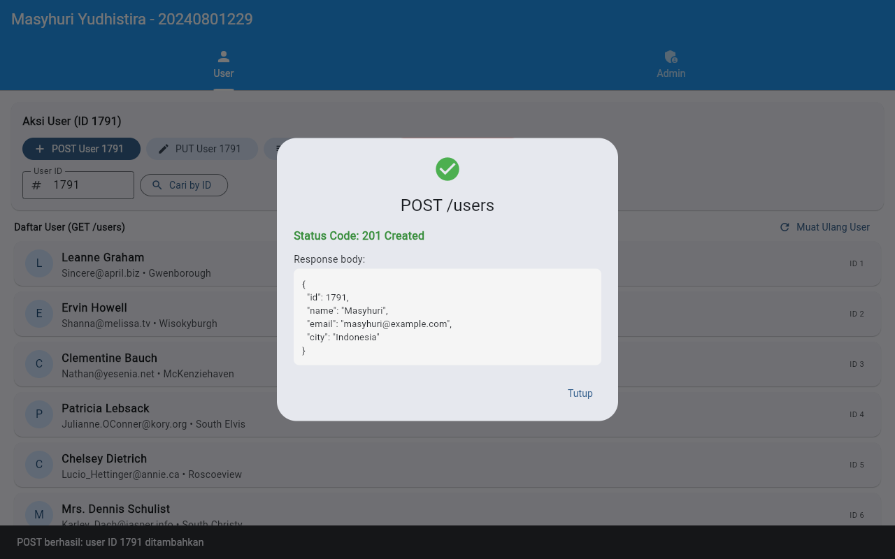

*Gambar 2. Hasil POST user ID 1791 (201 Created)*

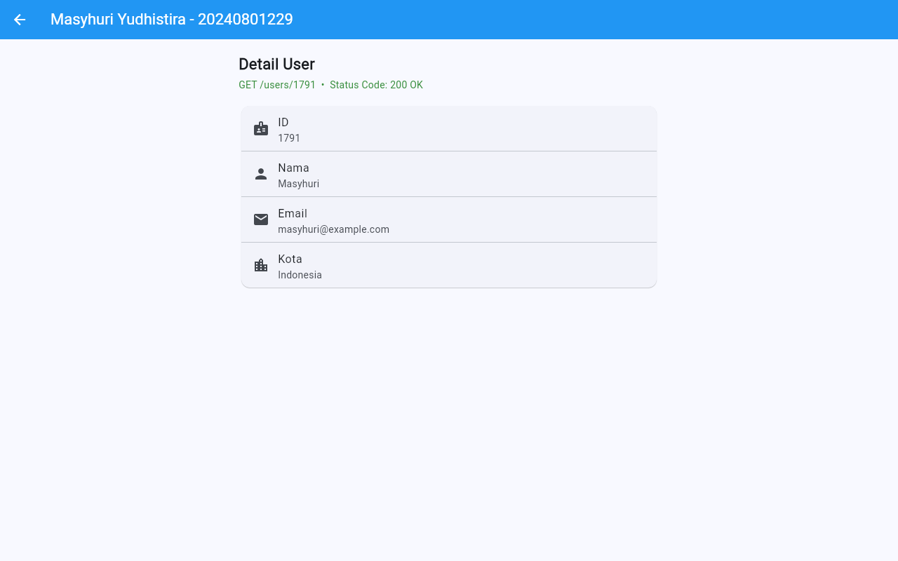

*Gambar 3. Detail user ID 1791 lewat tombol Cari by ID (GET /users/1791, 200 OK)*

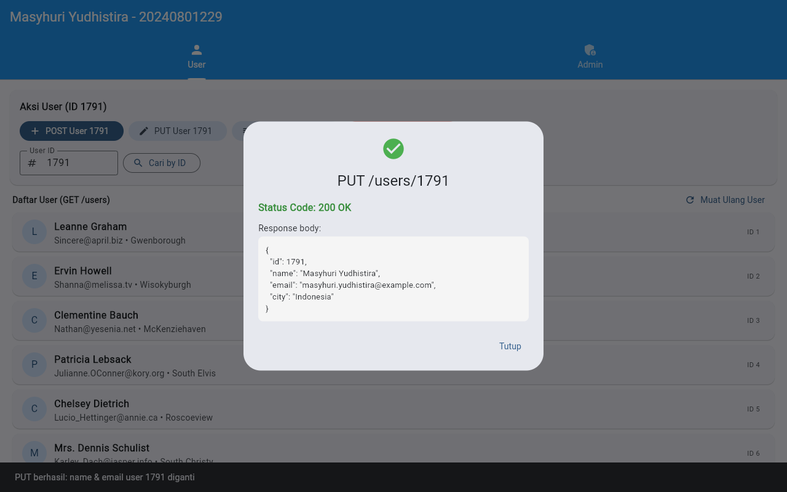

*Gambar 4. Hasil PUT user ID 1791, name dan email diganti (200 OK)*

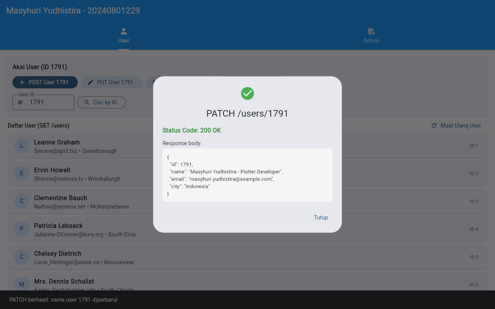

*Gambar 5. Hasil PATCH user ID 1791, name ditambah " - Flutter Developer" (200 OK)*

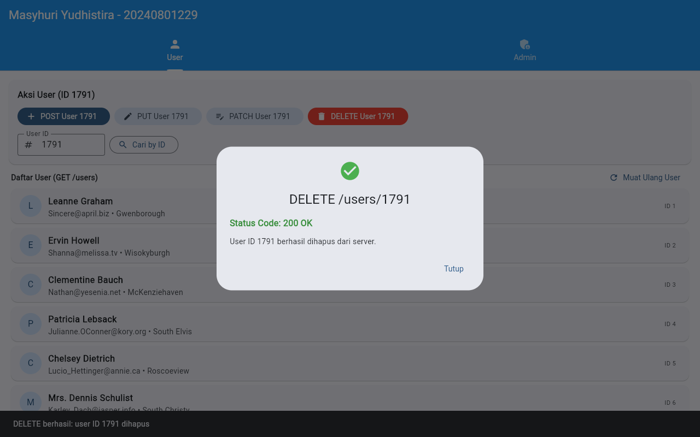

*Gambar 6. Hasil DELETE user ID 1791 (200 OK)*

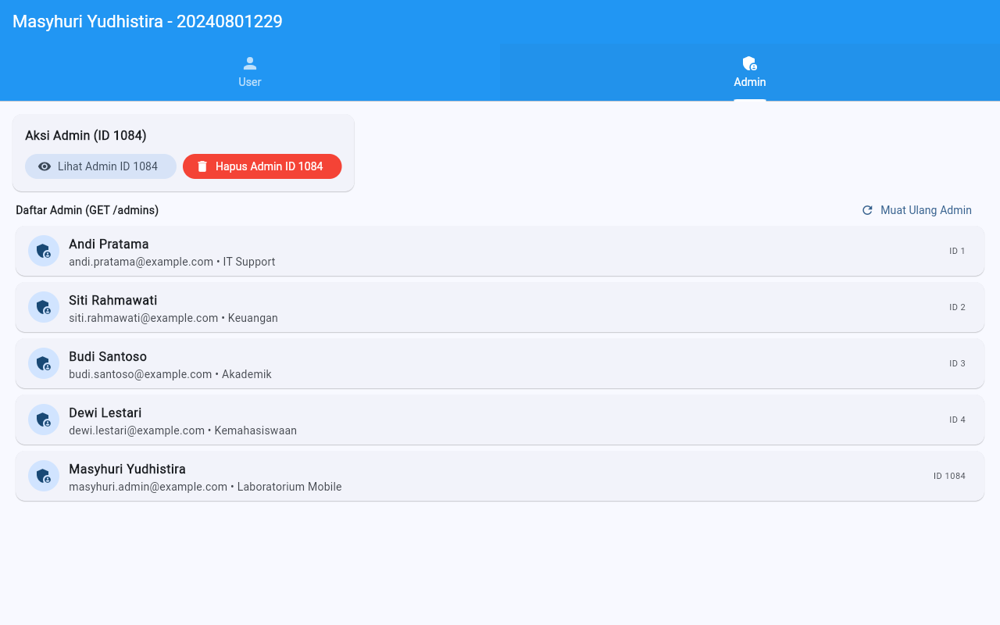

*Gambar 7. Tab Admin menampilkan daftar admin (GET /admins, 200 OK)*

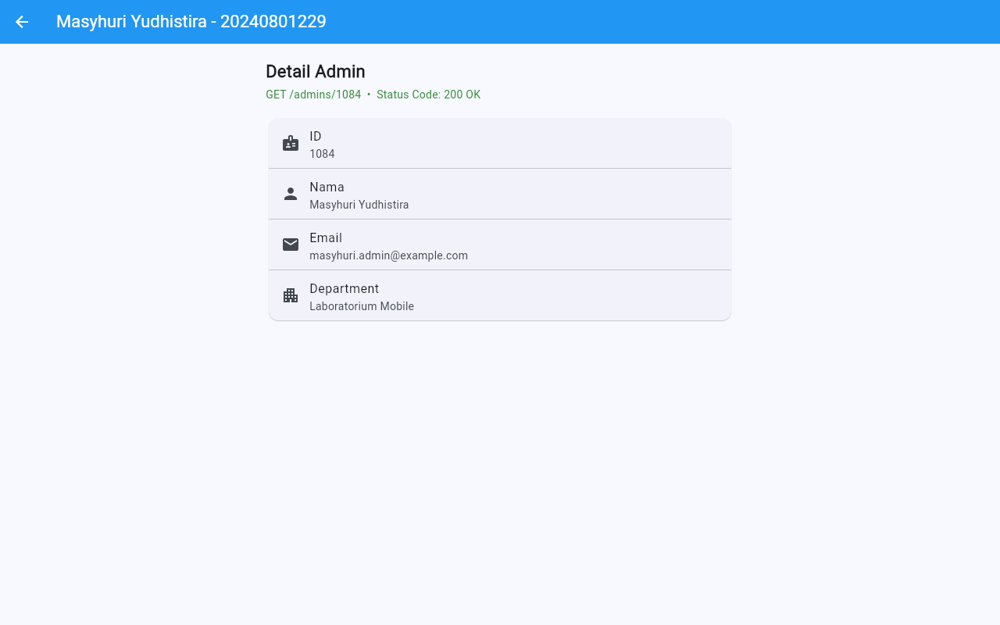

*Gambar 8. Detail admin ID 1084 (GET /admins/1084, 200 OK)*

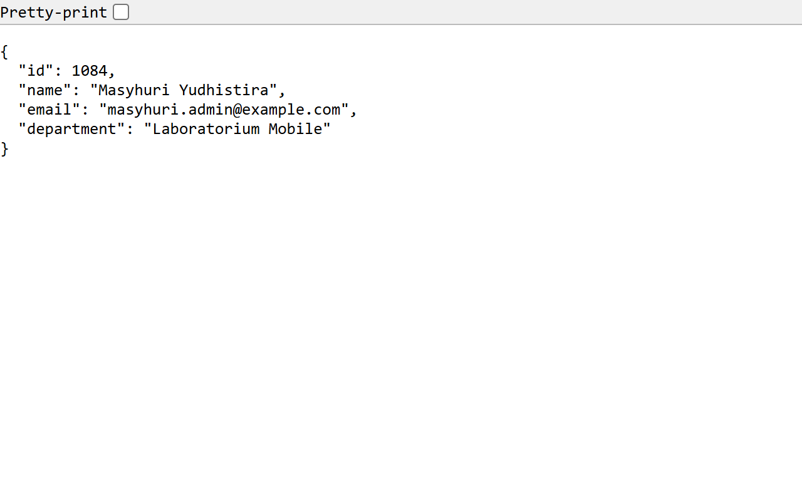

*Gambar 9. Bukti API sebelum dihapus: http://localhost:3000/admins/1084 mengembalikan data admin (HTTP 200)*

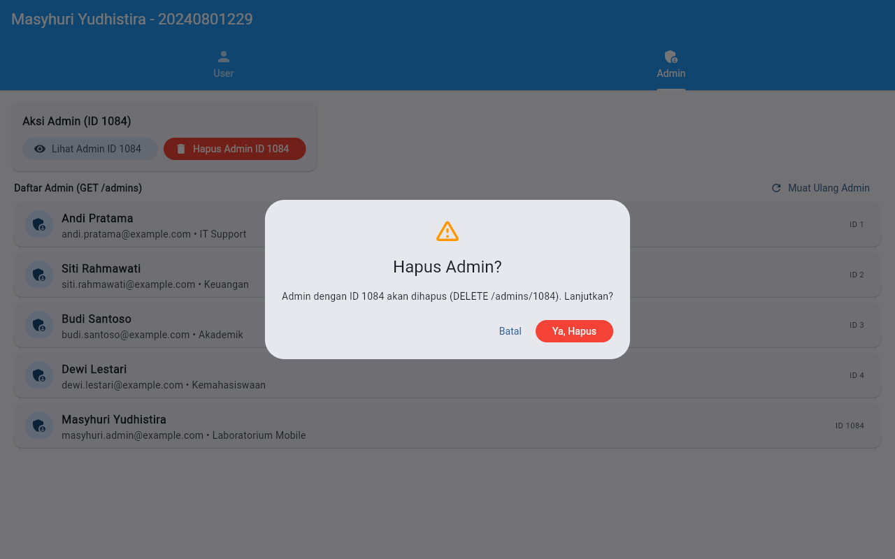

*Gambar 10. Dialog konfirmasi sebelum menghapus admin ID 1084*

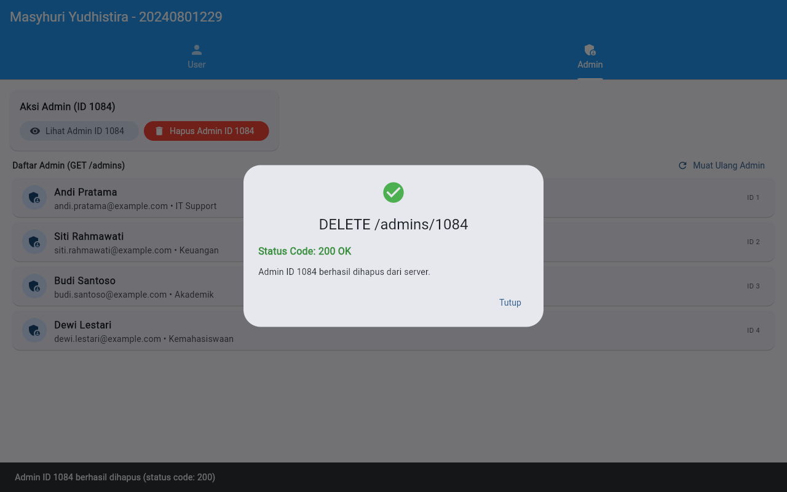

*Gambar 11. Hasil DELETE admin ID 1084 (200 OK), daftar admin langsung ter-refresh*

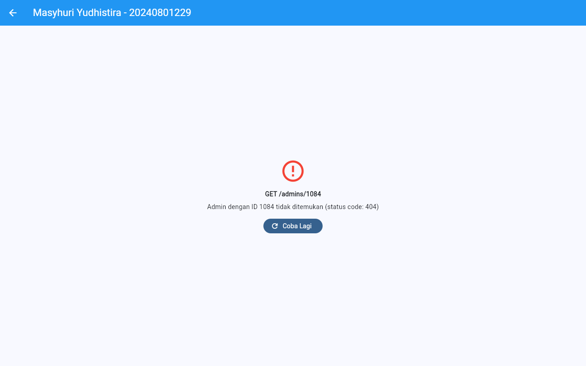

*Gambar 12. GET admin ID 1084 setelah dihapus menampilkan pesan 404*

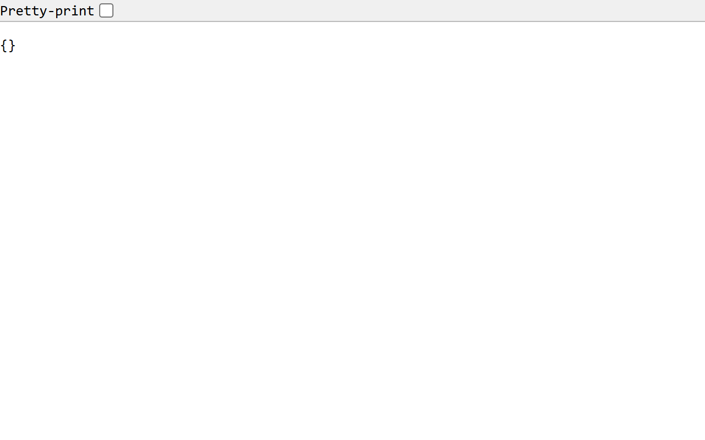

*Gambar 13. Bukti API sesudah dihapus: http://localhost:3000/admins/1084 mengembalikan {} (HTTP 404)*

## 9. Kesimpulan

Pada praktikum ini dibuat dua model data, yaitu User dan Admin, masing-masing dengan `fromJson()` untuk mengubah JSON menjadi objek Dart dan `toJson()` untuk kebalikannya. Setiap model punya service sendiri yang memakai package http untuk mengirim request GET, POST, PUT, PATCH, dan DELETE ke json-server. Hasil pengujian menunjukkan user ID 1791 berhasil dibuat, ditampilkan, diubah, dan dihapus, sedangkan admin ID 1084 berhasil ditampilkan lalu dihapus sehingga request berikutnya mendapat 404. Dengan mengecek status code di setiap request, aplikasi bisa membedakan request yang berhasil dan yang gagal lalu menampilkannya dengan jelas kepada pengguna.
